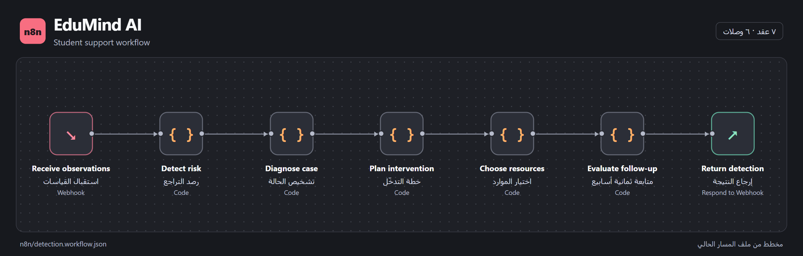

# EduMind AI · مسار دعم الطالب



تمرّر لوحة المعلّم القياسات عبر الخدمة الوسيطة إلى n8n. يعمل المسار بالتسلسل من الرصد إلى التشخيص ثم تخطيط التدخّل واختيار الموارد. تظهر خطة دعم لثمانية أسابيع، والأسبوع الأول هو خط الأساس. يحسب وكيل التقييم التغيّر عند إدخال قياس جديد ويحدّث التركيز للأسبوع القادم. يبقى مفتاح الاتصال على الخادم. فتح `index.html` مباشرةً يشغّل القواعد نفسها داخل المتصفح.

## إدخال نتائج أكثر من طالب

افتح تبويب **الطلاب** وأضف رمزًا مثل `S-001` مع علامة الرياضيات والحضور في القياس السابق وخط الأساس. احسب العلامة من 100 باستخدام اختبار قصير قابل للمقارنة مع الاختبارات التالية. احسب الحضور من سجلّ أيام الأسبوع. يمكنك إضافة نتيجة اختبار الكسور أو عدد أيام الغياب المتزامنة مع تأخّر الحافلة إذا كانت هذه المعلومات متوفرة.

بعد الحفظ، شغّل التحليل وافتح **خطة 8 أسابيع**. أدخل علامة الأسبوع وأيام الحضور، ثم اضغط **قيّم الأسبوع**. يحفظ المتصفح كل قياس تحت رمز الطالب ويستعيده عند إعادة فتح حالته. السجل خاص بالمتصفح وعنوان اللوحة المستخدمَين. يرسل الموقع إلى n8n القياسات فقط، ويبقى رمز الطالب في المتصفح.

بعد تعديل `detection.js` أو `diagnosis.js` أو `intervention.js`، أعِد توليد المسار بالأمر `node n8n/build-detection.cjs` من جذر المشروع، ثم أعد تشغيل النسخة المحلية لتحميل المسار الجديد.

## تشغيل اللوحة ومسار n8n على الجهاز

على Windows، من PowerShell في جذر المشروع، استخدم Node.js 24 وpnpm لتجهيز n8n في مجلد مؤقت.

```powershell
$runtime = Join-Path $env:TEMP 'edumind-n8n-runtime'
New-Item -ItemType Directory -Force -Path $runtime | Out-Null
pnpm --dir $runtime add n8n@2.48.6 --config.node-linker=hoisted --allow-build=sqlite3
node n8n/start-local.cjs
```

يفتح المشغّل n8n على `127.0.0.1:5678` واللوحة على `127.0.0.1:8080`. يستورد المسار وينشره في مساحة n8n مؤقتة، ويولّد مفتاحًا جديدًا لكل تشغيل. انتظر رسالة `Open EduMind`، ثم افتح [اللوحة](http://127.0.0.1:8080). للإيقاف استخدم `Ctrl+C` في طرفية التشغيل. إذا كان n8n مثبّتًا في مكان آخر فاضبط `EDUMIND_N8N_BIN` لمسار ملف `bin/n8n`.

## تجربة المسار في n8n

1. استورد `detection.workflow.json` من قائمة **Import from File**.
2. في عقدة **Receive observations**، أنشئ أو اختر بيانات اعتماد **Header Auth**. استخدم اسم الترويسة `X-Edumind-Key` وقيمة سرية تُحفظ في n8n.
3. اختر **Listen for Test Event** وأرسل طلب `POST` إلى **Test URL** بالترويسة نفسها ومحتوى `application/json`. استخدم بيانات تجريبية كالمثال أدناه.

```json
{
  "previous": { "mathScore": 82, "attendedDays": 5 },
  "current": { "mathScore": 54, "attendedDays": 3 },
  "evidence": {
    "fractionQuiz": { "correct": 2, "total": 6 },
    "lateBusOnAbsenceDays": 2
  }
}
```

الاستجابة المتوقعة مع الحالة `200`:

```json
{
  "risk": "high",
  "mathChange": -28,
  "attendanceChange": -2,
  "diagnosis": { "learning": "fractions", "transport": "possible-factor" },
  "plan": { "focus": "fractions", "sessions": 3, "minutes": 20 },
  "resources": ["fraction-video", "fraction-practice"],
  "roadmap": [
    { "week": 1, "focus": "fractions", "sessions": 3, "minutes": 20, "mathTarget": 60, "attendanceTarget": 4, "measurement": { "mathScore": 54, "attendedDays": 3 } }
  ]
}
```

تُحسب الفروق بطرح القيمة السابقة من الحالية. للتجربة، يُعدّ انخفاض 15 نقطة أو يومَي حضور إشارة تستحق الانتباه. النتيجة `high` عند بلوغ الحدّين، و`watch` عند بلوغ حدّ واحد، و`low` في غير ذلك. القواعد جزء من سيناريو الديمو.

يتطلب كل أسبوع علامة بعدد صحيح من 0 إلى 100، وعدد أيام حضور صحيحًا من 0 إلى 5. عند فقدان حقل أو وجود قيمة خارج النطاق، يعيد المسار الحالة `422` والرمز `INVALID_OBSERVATIONS`.

أدلة التشخيص اختيارية. نتيجة اختبار أقل من 60% توجّه الخطة نحو الكسور. عند غياب إشارة محددة يمكن اختيار مراجعة الاختبار. للحالات منخفضة الخطر، يكتفي المسار بالمتابعة. إذا تراجع الحضور وتزامن تأخّر الحافلة مع الغياب، يسجّل التشخيص ذلك كعامل محتمل.

تعيد `roadmap` ثمانية عناصر. عُرض الأسبوع الأول فقط في مثال الاستجابة أعلاه. للتقييم، أضف `"checkpoints": [{ "mathScore": 70, "attendedDays": 5 }]` إلى الطلب، ثم أضف كل قياس جديد إلى نهاية القائمة حتى الأسبوع الثامن. تعيد `evaluation` آخر قياس والفروق عن خط الأساس ومجال التدريب التالي. حالة آدم التجريبية تعرض قيمًا قابلة للتعديل وتبقى في جلسة الصفحة الحالية.

تنتقل الخطة من الكسور إلى المسائل الكلامية عند تحسّن العلامة حسب قواعد الديمو، ثم إلى المراجعة المتنوعة والتدريب المستقل عند بلوغ أهداف أعلى. عند التراجع في المسائل الكلامية، يمكن أن تعود الخطة إلى تأسيس الكسور. الأهداف الأسبوعية تخطيطية وتتكيّف توصية الأسبوع التالي مع القياسات المسجّلة.

للتوصيل بنسخة n8n موجودة، اضبط `EDUMIND_DETECTION_URL` إلى عنوان Webhook واضبط `EDUMIND_DETECTION_KEY` بمفتاح بيانات الاعتماد في بيئة الخادم، ثم شغّل `node server.cjs`.

## سجلّ Google Sheets والنقل

استورد مصنّف **EduMind AI - Pilot measurements.xlsx** إلى Google Sheets باستخدام حساب فيه مساحة متاحة. يتضمن ثلاثة رموز تجريبية بلا بيانات شخصية. أبقِ أسماء التبويبات وعناوين الأعمدة كما هي.

- **Measurements** يستقبل الصف السابق في الأسبوع 0 وخط الأساس في الأسبوع 1، ثم القياسات المتتابعة حتى الأسبوع 8. أدخل العلامة من 100 والحضور من 5. حقلا اختبار الكسور اختياريان ويُملآن معًا.
- **Transport** يستقبل رمز الطالب والأسبوع وعدد أيام الغياب التي تزامنت فعلًا مع تأخّر الحافلة. يمكن تزويد التبويب من سجل المدرسة أو من خدمة النقل بعد تحديد مصدرها. يقرأ وكيل التشخيص تطابق أسبوع خط الأساس ويعرضه كعامل قابل للتحقّق.
- **FollowUp** سجلّ مخرجات التقييم. عندما يقيّم المعلّم طالبًا محمّلًا من Sheets، تحفظ الخدمة القياس الجديد ونتيجة التقييم في عملية كتابة واحدة.

فعّل Google Sheets API لمشروع حساب الخدمة وامنحه صلاحية **Editor** على هذا المصنّف وحده. اضبط `EDUMIND_GOOGLE_SPREADSHEET_ID` إلى معرّف المصنّف و`EDUMIND_GOOGLE_CREDENTIALS_FILE` إلى مسار ملف اعتماد حساب الخدمة خارج مجلد المشروع. أعد تشغيل الخدمة ثم اضغط **تحميل سجل Google Sheets** في تبويب الطلاب. سجلات المتصفح المحلية تبقى منفصلة.

## OpenAI وإجراءات الدعم

لإظهار اقتراح تشخيص إضافي، اضبط `OPENAI_API_KEY` و`EDUMIND_OPENAI_MODEL` في بيئة الخادم. يرسل الموصل فئات الأدلة فقط، مثل وجود تراجع في الحضور أو إشارة ضعف في الكسور. يختار النموذج إجراءً من قائمة قصيرة ومقيّدة. يظل تحديد الخطر والخطة بيد قواعد الوكلاء، ويظهر الاقتراح في تفاصيل التشخيص.

في حالة الخطر المرتفع، توفر اللوحة خطوات للقاء الطالب، ومعالجة المهارة المحددة أو التحقق منها، ومراجعة الحضور، والتحقق من النقل عند وجود إشارة، ثم مراجعة التقدّم بعد أسبوع.

## تجربة المعلّم

ابدأ بثلاث حالات تجريبية من المصنّف. الأولى للتأكد من ظهور إجراءات الخطر المرتفع ودليل الكسور والنقل. الثانية لمراجعة حالة تحتاج متابعة دون دليل نقل. الثالثة للتأكد من أن الحالة منخفضة الخطر تقود إلى المراقبة. يراجع المعلّم سبب كل أولوية، ويُدخل قياس أسبوع واحد، ثم يعيد فتح الطالب للتأكد من رجوع القياس. سجّل هل استطاع تفسير الإجراء وحفظ القياس واسترجاعه، وأي خطوة احتاجت إلى مساعدة.
